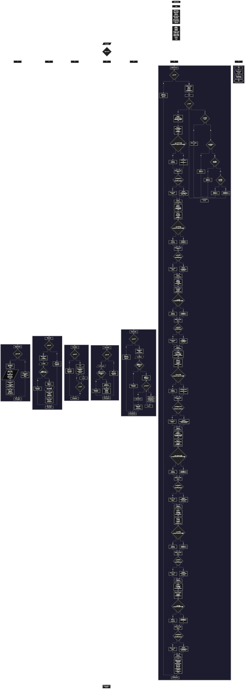

 

Este proyecto, llamado <b>artista musical</b>, fue desarrollado en <b>java</b> como un ejercicio práctico para fortalecer la lógica de programación mediante la creación de un sistema de gestión de artistas musicales desde la consola. El programa cuenta con un menú principal de siete opciones que permite <b>registrar, editar, listar, buscar, eliminar y consultar un resumen</b> de los artistas registrados. Cada artista almacena diez datos relacionados con su información, como el nombre artístico, nombre real, tipo de artista, género musical, país, instrumento, álbum destacado, canción destacada, año de inicio y estado. Para organizar estos datos se utilizan diez arreglos paralelos, cada uno con una capacidad máxima de <b>10 artistas durante la ejecución</b>. Durante su desarrollo se aplicaron conceptos fundamentales de programación, como variables, arreglos, estructuras condicionales, ciclos repetitivos y estructuras de selección, además de procesos para buscar, modificar, eliminar y reorganizar registros. También se implementó un resumen estadístico que permite identificar los valores más frecuentes y contabilizar los artistas según su estado. Este proyecto permite poner en práctica los conocimientos adquiridos en java y sirve como base para desarrollar sistemas de gestión más avanzados utilizando otros lenguajes y tecnologías.

<h2 align="center">⚙️ Funcionamiento del menú principal</h2>

### ➕ Registrar artista

La opción <b>1) registrar artista</b> permite almacenar un nuevo artista en el sistema. Antes de realizar el registro, el programa comprueba que la cantidad de artistas almacenados sea menor que la capacidad de los arreglos, utilizando la condición <b>total &gt;= nombresArtisticos.length</b> para determinar si se alcanzó el límite de <b>10 artistas</b>. Si existe espacio disponible, genera un identificador mediante la variable <code>id</code>, calculando <code>total + 1</code>, y solicita el <b>nombre artístico, nombre real, tipo de artista, género musical, país de origen, instrumento principal, álbum destacado, canción destacada, año de inicio y estado del artista</b>. Los datos se almacenan en la posición correspondiente de sus respectivos arreglos. Finalmente, muestra el mensaje <b>"artista registrado correctamente."</b> e incrementa la variable <code>total</code> en uno. Si se alcanza la capacidad máxima, presenta el mensaje <b>"no hay espacio para registrar más artistas."</b>, impidiendo agregar otro registro.

### ✏️ Editar artista

La opción <b>2) editar artista</b> permite modificar la información de un artista registrado. Primero, el programa comprueba si existen artistas almacenados mediante la condición <code>total == 0</code>. Si no hay registros, muestra el mensaje <b>"no existen artistas registrados."</b>. En caso contrario, presenta una lista con el ID, nombre artístico, nombre real, tipo, género, país, instrumento, álbum, canción, año de inicio y estado de cada artista. Después, solicita el ID del artista que se desea editar y comprueba que esté dentro del rango permitido mediante la condición <code>idEditar &gt;= 1 && idEditar &lt;= total</code>. Si la selección es válida, calcula la posición correspondiente restando uno al identificador mediante <code>posicion = idEditar - 1</code> y solicita los diez nuevos datos, actualizando directamente los valores de los arreglos correspondientes. Finalmente, presenta el mensaje <b>"artista actualizado correctamente."</b>. Si el ID seleccionado no corresponde a un artista registrado, muestra el mensaje <b>"id no encontrada."</b>.

### 📋 Listar artistas

La opción <b>3) listar artistas</b> permite visualizar todos los artistas registrados actualmente en el sistema. Antes de mostrar la información, el programa comprueba si la variable <code>total</code> es igual a cero. Si no existen registros, presenta el mensaje <b>"no existen artistas registrados."</b>. Si hay artistas disponibles, utiliza un ciclo <b>for</b> para recorrer los arreglos desde la primera posición hasta el número total de artistas registrados. Durante el recorrido, muestra el ID, nombre artístico, nombre real, tipo de artista, género musical, país, instrumento, álbum destacado, canción destacada, año de inicio y estado de cada artista. El identificador mostrado se obtiene mediante <code>i + 1</code>. Esta función facilita consultar todos los registros existentes sin necesidad de buscar cada artista individualmente.

### 🔎 Buscar artista

La opción <b>4) buscar artista</b> permite localizar un artista mediante su ID. Primero, el programa comprueba si existen artistas registrados. Si no hay registros, muestra el mensaje <b>"no existen artistas registrados."</b>. En caso contrario, solicita el identificador del artista que se desea buscar y comprueba que esté dentro del rango permitido mediante la condición <code>idBusqueda &gt;= 1 && idBusqueda &lt;= total</code>. Si el ID es válido, obtiene la posición correspondiente restando uno al identificador mediante <code>posicion = idBusqueda - 1</code> y muestra toda la información del artista encontrado: <b>nombre artístico, nombre real, tipo de artista, género musical, país, instrumento, álbum destacado, canción destacada, año de inicio y estado</b>. Si el ID introducido no corresponde a ningún registro, presenta el mensaje <b>"id no encontrada."</b>. La búsqueda se realiza directamente mediante el identificador y no mediante el nombre artístico.

### 🗑️ Eliminar artista

La opción <b>5) eliminar artista</b> permite eliminar un artista registrado mediante su ID dentro de la lista. Antes de comenzar, el programa comprueba que existan artistas almacenados. Si no hay registros, muestra el mensaje <b>"no existen artistas registrados."</b>. Si hay artistas disponibles, presenta una lista con la información de cada uno. Después, solicita el ID del artista que se desea eliminar y verifica que la selección esté dentro del rango válido. Si el artista existe, calcula su posición mediante <code>posicion = idEliminar - 1</code> y comienza el proceso de eliminación. Para mantener los registros organizados, utiliza un ciclo <b>for</b> controlado por la variable <code>i</code>, que desplaza una posición hacia atrás los datos de los artistas posteriores en los diez arreglos: <code>nombresArtisticos</code>, <code>nombresReales</code>, <code>tiposArtistas</code>, <code>generosMusicales</code>, <code>paises</code>, <code>instrumentos</code>, <code>albumesDestacados</code>, <code>cancionesDestacadas</code>, <code>anosInicio</code> y <code>estados</code>. Posteriormente, disminuye la variable <code>total</code> en uno y muestra el mensaje <b>"artista eliminado correctamente."</b>. Si el ID seleccionado no corresponde a un artista registrado, presenta el mensaje <b>"id no encontrada."</b>.

### 📊 Mostrar resumen

La opción <b>6) mostrar resumen</b> permite consultar información estadística de los artistas registrados. Primero, el programa comprueba si existen registros almacenados. Si no hay artistas, muestra el mensaje <b>"no existen artistas registrados."</b>. En caso contrario, inicializa cinco contadores para clasificar los estados de los artistas: <code>activos</code>, <code>enPausa</code>, <code>retirados</code>, <code>disueltos</code> y <code>otrosEstados</code>. Mediante un ciclo <b>for</b> y estructuras condicionales, recorre el arreglo <code>estados</code> y compara cada valor utilizando <code>equalsIgnoreCase()</code>, incrementando el contador correspondiente según el estado encontrado. Después, realiza siete análisis de frecuencia mediante ciclos <b>for</b> anidados para identificar el género musical, tipo de artista, país, instrumento, álbum, año de inicio y estado que aparecen con mayor frecuencia. Para estos análisis utiliza las variables <code>generoMayor</code>, <code>tipoMayor</code>, <code>paisMayor</code>, <code>instrumentoMayor</code>, <code>albumMayor</code> y <code>anoMayor</code>, junto con <code>estadoMayor</code> y sus respectivos contadores de frecuencia. Finalmente, muestra el total de artistas registrados, los siete valores más frecuentes y la cantidad de artistas clasificados en cada estado. Cuando existen valores con la misma frecuencia máxima, conserva el primero que alcanza dicha cantidad debido a que utiliza la condición de comparación <code>&gt;</code>.

### 🚪 Salir del menú principal

La opción <b>7) salir</b> está destinada a finalizar la ejecución del programa y muestra el mensaje <b>"gracias por utilizar artista musical."</b>. El menú principal se encuentra dentro de una estructura repetitiva <b>do-while</b>, que mantiene el programa en funcionamiento mientras se realizan las operaciones disponibles. La condición de repetición es <code>opcion != 7</code>, por lo que al seleccionar la opción 7 el ciclo termina. Finalmente, el programa cierra el objeto <code>entrada</code> mediante <code>entrada.close()</code>, liberando el recurso utilizado para recibir los datos ingresados por el usuario.

<h2 align="center">🧠 Temas aplicados en el proyecto</h2>

### 📦 Variables

En este proyecto se utilizan variables para almacenar la opción seleccionada en el menú, controlar la cantidad de artistas registrados, generar identificadores, seleccionar las posiciones de los artistas que se desean editar, buscar o eliminar, recorrer los arreglos y realizar los cálculos estadísticos. También se utilizan contadores para clasificar los estados y determinar los valores que aparecen con mayor frecuencia. Cada variable cumple una función específica dentro de las operaciones de gestión y análisis de los artistas musicales.

🔢 **Opcion:** Almacena la opción seleccionada por el usuario en el menú principal.

📊 **Total:** Almacena la cantidad actual de artistas registrados.

🆔 **Id:** Genera el identificador del nuevo artista mediante la suma de `total + 1`.

✏️ **IdEditar:** Almacena el identificador del artista que se desea editar.

🔎 **IdBusqueda:** Almacena el identificador del artista que se desea buscar.

🗑️ **IdEliminar:** Almacena el identificador del artista que se desea eliminar.

📍 **Posicion:** Almacena la posición del arreglo correspondiente al identificador seleccionado.

🔄 **I y j:** Funcionan como contadores para recorrer los arreglos y comparar los registros durante las operaciones de gestión y análisis estadístico.

📊 **Activos, enPausa, retirados, disueltos y otrosEstados:** Almacenan las cantidades de artistas clasificados según su estado.

🏆 **GeneroMayor, tipoMayor, paisMayor, instrumentoMayor, albumMayor, anoMayor y estadoMayor:** Almacenan los valores que aparecen con mayor frecuencia en sus respectivos arreglos.

🔢 **CantidadGeneroMayor, cantidadTipoMayor, cantidadPaisMayor, cantidadInstrumentoMayor, cantidadAlbumMayor, cantidadAnoMayor y cantidadEstadoMayor:** Almacenan las frecuencias máximas encontradas durante los análisis estadísticos.

🔁 **CantidadGenero, cantidadTipo, cantidadPais, cantidadInstrumento, cantidadAlbum, cantidadAno y cantidadEstado:** Funcionan como contadores temporales para calcular las coincidencias entre los valores de cada arreglo.

### 🗃️ Arreglos

En este proyecto se utilizan diez arreglos relacionados con los datos de cada artista musical. Cada arreglo tiene una capacidad de <b>10 posiciones</b> y utiliza el mismo índice para representar la información correspondiente a una misma persona. Por ejemplo, los datos de un artista almacenado en la posición <b>0</b> se encuentran distribuidos entre los diez arreglos que contienen su información. Esta organización permite recorrer, buscar, modificar, mostrar, eliminar y analizar los artistas de manera ordenada durante la ejecución del programa.

🎤 **NombresArtisticos[10]:** Almacena los nombres artísticos de los artistas registrados.

📝 **NombresReales[10]:** Almacena los nombres reales de los artistas.

🎭 **TiposArtistas[10]:** Almacena los tipos de artistas registrados.

🎼 **GenerosMusicales[10]:** Almacena los géneros musicales de los artistas.

🌎 **Paises[10]:** Almacena los países de origen de los artistas.

🎸 **Instrumentos[10]:** Almacena los instrumentos principales de los artistas.

💿 **AlbumesDestacados[10]:** Almacena los álbumes destacados de los artistas.

🎵 **CancionesDestacadas[10]:** Almacena las canciones destacadas de los artistas.

📅 **AnosInicio[10]:** Almacena los años de inicio de los artistas.

📌 **Estados[10]:** Almacena los estados actuales de los artistas.

### 🔀 Estructuras condicionales

En este proyecto se utilizan las estructuras <b>if</b>, <b>else if</b> y <b>else</b> para comprobar si existe espacio disponible antes de registrar un artista, verificar si hay registros antes de realizar determinadas operaciones, validar el identificador seleccionado para editar, buscar o eliminar un artista y clasificar los registros según su estado. También permiten determinar si una frecuencia encontrada supera la cantidad máxima anterior durante los análisis estadísticos. Estas condiciones permiten que el programa responda de manera diferente según el estado de los registros y el resultado de cada operación.

### 🔄 Estructuras repetitivas

En este proyecto se utilizan los ciclos <b>for</b> y <b>do-while</b>. Los ciclos <b>for</b> permiten recorrer los arreglos para mostrar los artistas, consultar sus datos, desplazarlos durante la eliminación y clasificarlos según sus estados. También se utilizan ciclos <b>for</b> anidados para comparar los valores almacenados en cada arreglo y determinar cuáles aparecen con mayor frecuencia. Por otro lado, el ciclo <b>do-while</b> mantiene activo el menú principal para que el usuario pueda ejecutar diferentes operaciones antes de seleccionar la opción de salida.

### 🎯 Estructura según

El programa utiliza la estructura <b>switch</b> para evaluar el valor almacenado en la variable <code>opcion</code> y ejecutar el bloque de instrucciones correspondiente. Cada caso representa una operación específica del sistema: <b>registrar artista, editar artista, listar artistas, buscar artista, eliminar artista, mostrar resumen o salir</b>. También se utiliza el bloque <b>default</b> para mostrar el mensaje <b>"opcion no valida."</b> cuando el usuario introduce un número que no coincide con ninguna de las opciones definidas en el menú.

### 🔢 Dimensionamiento de arreglos

El programa utiliza la instrucción <b>new String[10]</b> para establecer la capacidad de los diez arreglos que almacenan la información de los artistas. Cada arreglo dispone de <b>10 posiciones</b>, lo que permite administrar hasta diez artistas durante la ejecución. La cantidad de posiciones ocupadas se controla mediante la variable <code>total</code>, por lo que las operaciones recorren únicamente los registros comprendidos entre la primera posición y el total actual de artistas. Además, se utiliza la propiedad <code>length</code> del arreglo <code>nombresArtisticos</code> para comprobar la capacidad máxima antes de registrar un nuevo artista.

### 🔄 Reorganización de registros

Cuando se selecciona un artista para eliminarlo, el programa utiliza un ciclo <b>for</b> que comienza en la posición seleccionada y llega hasta <code>total - 1</code>. En cada repetición, los datos de la posición siguiente se copian sobre la posición actual en los diez arreglos: <code>nombresArtisticos</code>, <code>nombresReales</code>, <code>tiposArtistas</code>, <code>generosMusicales</code>, <code>paises</code>, <code>instrumentos</code>, <code>albumesDestacados</code>, <code>cancionesDestacadas</code>, <code>anosInicio</code> y <code>estados</code>. Después, la variable <code>total</code> disminuye en uno. De esta manera, los artistas posteriores ocupan las posiciones disponibles sin dejar espacios vacíos entre los registros activos. La última posición no se limpia explícitamente, pero deja de formar parte de los registros activos porque el total disminuye.

<h2 align="center">¿Cómo se implementaron las operaciones crud en el proyecto?</h2>

Las operaciones <b>crud</b> se implementaron mediante las opciones del menú principal, permitiendo administrar la información de los artistas musicales registrados. La operación <b>crear</b> corresponde a <b>registrar artista</b>, donde se introducen los diez datos de un nuevo artista; <b>leer</b> se realiza mediante las opciones <b>listar artistas y buscar artista</b>, que permiten consultar todos los registros o localizar uno mediante su identificador; <b>actualizar</b> corresponde a <b>editar artista</b>, donde se modifican los datos de un artista existente; y <b>eliminar</b> se realiza mediante la opción <b>eliminar artista</b>, que desplaza los datos posteriores para mantener organizados los arreglos. Estas operaciones utilizan variables, arreglos, condicionales y ciclos para gestionar la información almacenada temporalmente durante la ejecución del programa. Además, la opción <b>mostrar resumen</b> complementa la gestión mediante el análisis de frecuencias y la clasificación de los artistas según sus estados.

<h2 align="center">Diagrama de flujo del proyecto</h2>

<h2 align="center">🛡️ Validaciones del programa</h2>

### 📭 No existen artistas registrados

Esta validación se utiliza en las opciones de <b>editar, listar, buscar, eliminar y mostrar resumen</b>. El programa comprueba si la variable <code>total</code> es igual a <b>0</b> y, si no existen artistas registrados, muestra el mensaje <b>"no existen artistas registrados."</b>. Esta comprobación evita continuar con las operaciones que necesitan información almacenada cuando no hay registros disponibles.

### ⚠️ Capacidad máxima de artistas

Esta validación se utiliza durante el registro de nuevos artistas para controlar la capacidad máxima de los arreglos. El programa comprueba si <code>total &gt;= nombresArtisticos.length</code> antes de permitir agregar un nuevo registro. Si existe espacio disponible, solicita los datos del artista y aumenta el contador en uno. En caso contrario, muestra el mensaje <b>"no hay espacio para registrar mas artistas."</b>, impidiendo registrar más artistas mientras se mantenga la capacidad máxima de diez registros.

### ❌ ID no encontrado

Esta validación se utiliza durante las operaciones de <b>editar, buscar y eliminar artista</b>. El programa comprueba que el identificador introducido sea mayor o igual a <b>1</b> y menor o igual al valor de <code>total</code>. Si el ID se encuentra dentro de ese rango, calcula la posición correspondiente restando uno al identificador mediante <code>posicion = id - 1</code> y permite realizar la operación solicitada. Si el identificador no corresponde a ningún artista registrado, muestra el mensaje <b>"id no encontrada."</b>. Esta comprobación evita acceder a posiciones que no corresponden a registros activos.

### 🔢 Identificación de artistas

El programa utiliza el número de posición de los arreglos más uno para identificar a cada artista. Durante el registro, genera el identificador mediante <code>total + 1</code>. En las operaciones de edición, búsqueda y eliminación, convierte el ID introducido en una posición válida restando uno. Por esta razón, no utiliza un arreglo independiente para almacenar identificadores, sino que relaciona cada artista con su posición dentro de los arreglos. Después de eliminar un registro, los datos posteriores se desplazan y los identificadores mostrados corresponden nuevamente a las posiciones actualizadas.

### ⚠️ Opción inválida

La estructura <b>switch</b> incluye el bloque <b>default</b>, que muestra el mensaje <b>"opcion no valida."</b> cuando el usuario introduce un número que no corresponde a ninguna de las siete opciones definidas en el menú principal. Esta comprobación permite informar al usuario cuando selecciona una opción que no está contemplada en el programa.

<h2 align="center">🎯 Objetivo del proyecto</h2>

El objetivo principal de este proyecto es fortalecer la <b>lógica de programación</b> mediante el desarrollo de un sistema de gestión de artistas musicales en <b>java</b>. A través de su construcción se busca aplicar los conocimientos adquiridos sobre variables, arreglos, estructuras condicionales, ciclos repetitivos y estructuras de selección, integrándolos para resolver un problema de manera organizada. Además, el proyecto permite comprender cómo registrar, consultar, modificar y eliminar información mediante arreglos paralelos, así como realizar análisis de frecuencia y clasificar registros según diferentes estados. De esta manera, se establece una base para desarrollar sistemas de gestión más completos con otros lenguajes y tecnologías.

